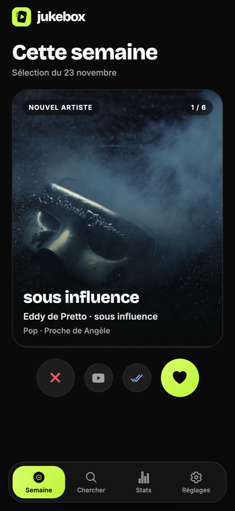
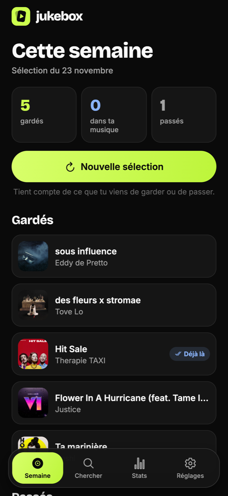
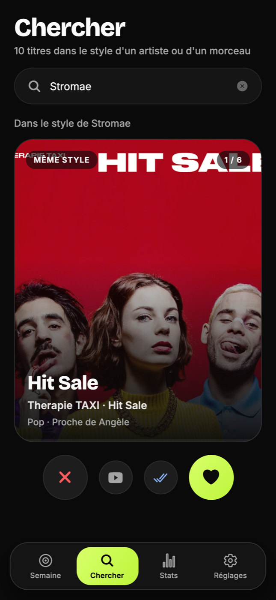
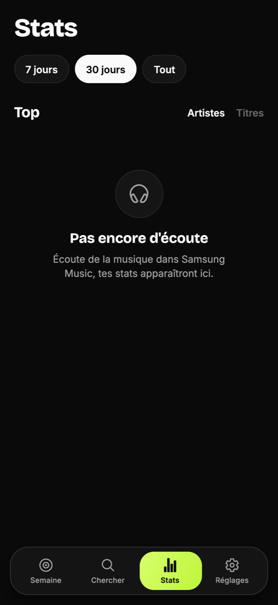

<div align="center">
  
  <h1>JukeBox for Android</h1>
  <p>Fifteen new songs every Monday, picked from what you actually play in Samsung Music.</p>
  <p>Swipe through 30 second previews, keep what you like, and the songs land in your phone's music, tagged and ready to play offline.</p>

  
  
  
</div>

Made for people who listen to their own music files in Samsung Music, without a streaming subscription. Finding new songs usually means hunting for them by hand. JukeBox does the hunting: it notices what you play, finds what sounds close, and lets you sort it like a deck of cards on Monday morning.

<p align="center">
  
  
  
  
</p>

## Download

[](https://apps.obtainium.imranr.dev/redirect?r=obtainium://add/https://github.com/matteogalfre/JukeBox)
[](https://github.com/matteogalfre/JukeBox/releases/latest)

Obtainium keeps the app up to date straight from this repository's releases. Android 11 or newer, arm64 phones.

> The interface is in French for now.

## Features

- [x] Follows what Samsung Music plays (title, artist, how long you really listened), nothing else
- [x] Every Monday at 8 am, 15 songs: about 70 % from artists you don't have yet, 30 % songs you're missing from artists you already like
- [x] Split by your style playlists (Rap FR, Chill...) and by what you're listening to right now
- [x] Sort with a swipe: right to keep, left to pass, or tap "I already have it". The preview starts by itself
- [x] Kept songs download over Wi-Fi only, as 320 kbps mp3 with title, artist, album, year and cover, into `Music/JukeBox/Découvertes`
- [x] The following Monday, a song you played in full twice moves to `Music/JukeBox`. Never played in full, it's deleted
- [x] Learns from your sorting: how fast you passed a song, whether you opened it on YouTube, whether you kept listening afterwards
- [x] Song by song suggestions: what people play right after your favourite songs (ListenBrainz)
- [x] Optional ListenBrainz account: your full listens are sent there, and your personal Weekly Exploration joins the Monday selection
- [x] On demand: type an artist or a song, get 10 songs in that style
- [x] Stats: top artists and songs, listening habits, how your discoveries turned out
- [x] No live versions, no duplicates of songs already on the phone

## How it picks songs

1. **Your seeds.** At first, the artists that have the most songs on your phone and in your playlists. After about 40 full listens, mostly what you actually play, recent listens counting more (half the weight after 4 weeks). Discoveries you loved count too.
2. **Close artists.** ListenBrainz similar artists (computed from what all its users listen to) and Deezer related artists. Artists named by both, or by several of your seeds, come first.
3. **Close songs.** For your favourite songs of the moment, the songs ListenBrainz users play right after them. Huge hits that follow everything get pushed down, and songs outside your styles are left out.
4. **Your sorting.** Every song you sorted gets a score: kept, passed after 3 seconds or after the whole preview, opened on YouTube, played in full later, kept or deleted on Monday. Genres and artists you pass go down, the ones you keep go up, and an artist you clearly don't like stops coming back.
5. **Variety.** Your strongest seeds are always used, the others rotate from week to week, and an artist suggested recently without being kept makes room for others.

## Privacy

Everything stays on the phone, in a local database. The app talks to:

- **Deezer** (public API, no key, no account): artists, top songs, genres, covers and previews;
- **MusicBrainz** and **ListenBrainz** (no account): IDs of artists and songs, similar artists and songs. Only artist and song names are sent;
- **YouTube**, through [yt-dlp](https://github.com/yt-dlp/yt-dlp), for the songs you keep;
- your **ListenBrainz account**, only if you link it in the settings. Your listening history then becomes public on your ListenBrainz profile.

No analytics, no ads, no tracking.

## Permissions

Three things to allow on first launch, from the app's home screen:

- **Music and audio**: to know what's already on the phone and read your playlists;
- **Notification access**: Android only lets an app see what another app is playing through this. JukeBox doesn't read your notifications;
- **Unrestricted battery**: so Android doesn't stop the listening tracker in the background.

## Run it from source

```bash
npm install
npm test                  # taste scoring rules
npx tsc --noEmit
npx expo start --web      # demo mode in the browser, nothing tracked or downloaded
```

Try the engine from a computer with real data:

```bash
npx tsx scripts/essai-reco.mts "Stromae" "Orelsan" "Angèle"
npx tsx scripts/essai-titres.mts "Stromae - Formidable" "Angèle - Balance ton quoi"
```

Build the APK (Java 17 and the Android SDK):

```bash
npx expo prebuild -p android --clean --no-install
cd android && ./gradlew assembleRelease
```

`scripts/build-apk.sh` does the same and signs with the release key, which isn't in this repository.

## Under the hood

- Expo and React Native, Expo Router, SQLite
- `modules/ecoute`: Kotlin service that follows Samsung Music's media sessions, reads the phone's music, and holds the audio focus while you sort so Samsung Music stays paused
- `modules/telechargeur`: yt-dlp (via youtubedl-android) and ffmpeg, picks the right video (duration, "Topic" channels, no live or remix), ID3 tags, MediaStore, a Wi-Fi only WorkManager queue
- `src/lib/reco.ts` and `src/lib/titres.ts`: the engine, artist by artist and song by song
- `src/lib/gout.ts`: how your sorting turns into scores
- `src/lib/semaine.ts`: the weekly cycle (selection, downloads, Monday clean-up)

## Fair use

JukeBox is a personal tool. Download only what you're allowed to in your country, and support the artists you discover: concerts, merch, records.

## Feedback and contributions

Bug reports and ideas are welcome [here](https://github.com/matteogalfre/JukeBox/issues), pull requests too.

## Credits

[ListenBrainz](https://listenbrainz.org) and [MusicBrainz](https://musicbrainz.org) (MetaBrainz Foundation), the [Deezer API](https://developers.deezer.com/api), [yt-dlp](https://github.com/yt-dlp/yt-dlp) through [youtubedl-android](https://github.com/yausername/youtubedl-android), [mp3agic](https://github.com/mpatric/mp3agic).

## License

JukeBox is licensed under the [GNU General Public License v3](LICENSE): you can use, study, change and share it, as long as your version stays open too.
